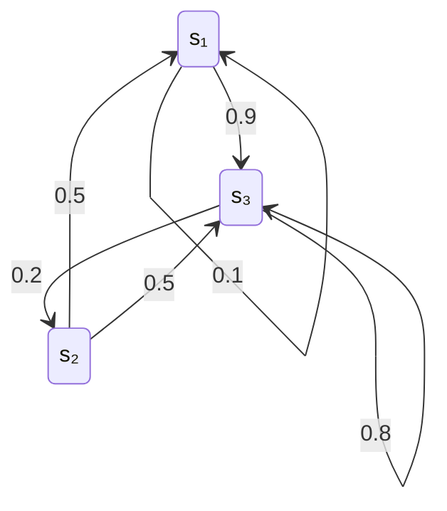

# 从单个符号到整个信源

[[信息熵]]讨论单个随机变量的不确定性，以及两个变量之间的联合熵、条件熵和互信息。研究一个持续输出消息的[[信源]]，还要回答三个问题：前后符号的依赖如何影响平均信息量；幅度连续时怎样定义熵；已知信源的统计结构后，能减少多少传输或存储开销。

教材第 2.5、2.6、2.7 节依次围绕这三个问题展开。本笔记沿用教材的$H_N(X)$、$H_\infty(X)$、$H_c(X)$、$\eta$与$\gamma$等记号，默认$\log=\log_2$。使用自然对数$\ln$时，信息量单位相应为奈特（nat）。

| 记号 | 含义 | 所描述的范围 |
| --- | --- | --- |
| $H(X_1)$ | 单符号熵 | 单看一个位置的不确定性 |
| $H(X^N)$ | 长度为$N$的序列联合熵 | 一整组符号的不确定性 |
| $H_N(X)=H(X^N)/N$ | 分组后的每符号平均熵 | 按$N$个符号一组计算的平均信息量 |
| $H(X_N\mid X_1\cdots X_{N-1})$ | 已知前文时的条件熵 | 第$N$个符号新增的信息量 |
| $H_\infty(X)$ | 极限熵，也称熵率 | 长期平均每个符号新增的信息量 |
| $H_c(X)$ | 连续变量的微分熵 | 固定幅度尺度下由概率密度定义的熵 |

# 2.5 离散信源序列的熵

## 2.5.1 消息序列信息量的一般表达式

### 扩展信源：把一组符号看成一个新符号

设信源每次输出一个符号，符号集为$A=\{a_1,\dots,a_r\}$。长度为$N$的输出序列用随机矢量表示：

$$
X^N=(X_1,X_2,\dots,X_N)
$$

将每个可能的$N$元组看成一个新符号，就得到原信源的**$N$次扩展信源**。它的符号集$A^N$共有$r^N$个元组，其中一些元组的出现概率可以为零。

若某个具体序列记为$\alpha=(a_{i_1},\dots,a_{i_N})$，则其概率和自信息量为：

$$
p(\alpha)=P(X_1=a_{i_1},\dots,X_N=a_{i_N}),\qquad
I(\alpha)=-\log p(\alpha)
$$

对所有序列求平均，得到**序列联合熵**：

$$
\boxed{
H(X^N)=H(X_1\cdots X_N)
=-\sum_{\alpha\in A^N}p(\alpha)\log p(\alpha)
}
$$

它以比特/组计；除以每组符号数后，得到以比特/符号计的平均熵：

$$
\boxed{H_N(X)=\frac1N H(X_1\cdots X_N)}
$$

扩展信源同时保留了符号出现频率和组内的依赖关系，因此能够描述单符号概率表无法体现的结构。[^序列与无记忆]

### 概率链式分解与熵的链式法则

对任意具有正概率的具体序列，有：

$$
p(x_1,\dots,x_N)
=p(x_1)\prod_{n=2}^{N}p(x_n\mid x_1,\dots,x_{n-1})
$$

取负对数，乘积变成求和：

$$
I(x_1,\dots,x_N)
=I(x_1)+\sum_{n=2}^{N}I(x_n\mid x_1,\dots,x_{n-1})
$$

再按联合分布求期望，就得到：

$$
\boxed{
H(X_1\cdots X_N)
=H(X_1)+\sum_{n=2}^{N}H(X_n\mid X_1\cdots X_{n-1})
}
$$

这条公式可以理解为逐步确定整段消息：第一个符号提供初始信息，后续每个符号提供在已有前文基础上新增的信息。组内存在依赖时，前文能够帮助预测后文，新增的信息量就会减少。

## 2.5.2 离散无记忆信源的熵

若各位置的输出相互独立，条件概率退化为边缘概率：

$$
p(x_1,\dots,x_N)=\prod_{n=1}^{N}p(x_n)
$$

由链式法则可得：

$$
H(X_1\cdots X_N)=\sum_{n=1}^{N}H(X_n),\qquad
H_N(X)=\frac1N\sum_{n=1}^{N}H(X_n)
$$

若输出还同分布，即通常所说的离散无记忆信源，则所有位置的熵相同：

$$
\boxed{H(X^N)=NH(X_1),\qquad H_N(X)=H(X_1)}
$$

因此，独立同分布信源中，扩大分组不会减少理论上的每符号平均信息量。实际编码仍可通过扩大分组，减小码长取整数等因素造成的开销。[^序列与无记忆]

例如，等概率输出$0,1$时，单符号熵为$1$；任意$N$个符号的联合熵为$N$，每符号平均熵始终为$1$比特/符号。

## 2.5.3 离散有记忆信源的熵

### 平稳性：平移观察起点，统计规律不变

下面讨论有限字母表的离散平稳信源。这里的平稳性指各阶联合分布具有时间平移不变性，即[[平稳随机过程#严格平稳过程|严格平稳性]]。例如，对任意长度$N$和允许的起点$k$，有：

$$
P(X_1=x_1,\dots,X_N=x_N)
=P(X_{k+1}=x_1,\dots,X_{k+N}=x_N)
$$

它保证各位置具有相同的边缘分布，同时也保证相同相对位置的联合分布一致。符号之间仍然可以具有很强的依赖。

### 先看两个相邻符号

记相邻符号的联合概率为$p(a_i,a_j)$，条件概率为$p(a_j\mid a_i)$。已知前一个符号时，后一个符号的平均新增信息量为：

$$
\begin{aligned}
H(X_2\mid X_1)
&=\sum_i p(a_i)H(X_2\mid X_1=a_i)\\
&=-\sum_{i,j}p(a_i,a_j)\log p(a_j\mid a_i).
\end{aligned}
$$

于是：

$$
\begin{aligned}
H(X_1X_2)&=H(X_1)+H(X_2\mid X_1),\\
H_2(X)&=\frac12\bigl[H(X_1)+H(X_2\mid X_1)\bigr].
\end{aligned}
$$

平稳性与条件熵的性质给出：

$$
H(X_1)=H(X_2),\qquad
H(X_2\mid X_1)\leq H(X_1),\qquad
H_2(X)\leq H(X_1)
$$

后两个不等式的等号，当且仅当这两个相邻符号独立时成立。依赖关系使两个符号包含一部分重复信息，所以两者的联合熵不超过单符号熵的两倍。[^有记忆与极限熵]

### 教材例 2.12：同样的符号频率，不同的序列结构

设两个符号的边缘概率均为$0.5$，相邻符号的联合分布为：

$$
P_{X_1X_2}=\begin{bmatrix}
0.45&0.05\\
0.05&0.45
\end{bmatrix}
$$

单看任何一个位置，两种结果同样可能，因此$H(X_1)=1$。但相邻符号有$0.9$的概率相同，知道前一个符号后，对下一个符号就有较强的预测依据：

$$
\begin{aligned}
H(X_2\mid X_1)&=-0.9\log0.9-0.1\log0.1\approx0.4690,\\
H(X_1X_2)&=1+0.4690\approx1.4690,\\
H_2(X)&\approx0.7345\ \text{比特/符号}.
\end{aligned}
$$

其中，$0.4690$描述已知前一个符号后新增的信息；$0.7345$还平均了每组第一个符号的初始不确定性。它们衡量的范围不同，因而数值也不同。

### 一般平稳信源：四个重要结论

为便于推导，暂记：

$$
c_1=H(X_1),\qquad
c_N=H(X_N\mid X_1\cdots X_{N-1})\quad(N\geq2)
$$

这里$c_N$表示第$N$个符号在前文已知后的新增信息量。链式法则立即给出：

$$
H(X^N)=\sum_{n=1}^{N}c_n,\qquad
H_N(X)=\frac1N\sum_{n=1}^{N}c_n
$$

**结论一：新增信息量随可利用的前文增长而非递增。**

$$
\boxed{0\leq c_N\leq c_{N-1}\leq\cdots\leq c_1}
$$

证明结合了两个步骤：增加条件不会增加平均条件熵；平稳性允许整体平移下标。

$$
\begin{aligned}
H(X_N\mid X_1\cdots X_{N-1})
&\leq H(X_N\mid X_2\cdots X_{N-1})\\
&=H(X_{N-1}\mid X_1\cdots X_{N-2}).
\end{aligned}
$$

对$N=2$，相应结论就是$H(X_2\mid X_1)\leq H(X_1)$。

**结论二：分组平均熵不小于最后一个符号的新增信息量。**

$$
\boxed{H_N(X)\geq c_N}
$$

因为$H_N(X)$是$c_1,\dots,c_N$的平均，而$c_N$是其中最小的一项。对整组求平均时，组开头利用的前文较少，因此平均值包含了较大的初始不确定性。

**结论三：分组平均熵随组长增长而非递增。**

$$
\boxed{H_N(X)\leq H_{N-1}(X)}
$$

可由下式看出：

$$
H_N(X)=\frac{N-1}{N}H_{N-1}(X)+\frac1N c_N
$$

新加入的$c_N$不大于先前的平均值，因此新的平均值不会增加。扩大分组使组内能够利用更长的依赖关系，同时摊薄组开头的开销。

**结论四：两类平均量趋于相同的极限。**

$$
\boxed{
H_\infty(X)
=\lim_{N\to\infty}H_N(X)
=\lim_{N\to\infty}H(X_N\mid X_1\cdots X_{N-1})
}
$$

$c_N$非递增且下界为零，所以存在极限；收敛序列的算术平均具有相同极限，因而$H_N(X)$也收敛到该值。教材称它为**极限熵**或极限信息量，通常也称**熵率**，单位为比特/符号。这里的“率”按符号数归一化。

综合起来：

$$
0\leq H_\infty(X)\leq c_N\leq H_N(X)\leq H_1(X)\leq\log r
$$

熵率描述充分利用过去信息后，信源每输出一个符号仍会产生多少新的不确定性。用有限组长近似时，$H_N(X)$与$c_N$都给出熵率的上界；平稳性本身不规定它们收敛得多快。[^有记忆与极限熵]

## 2.5.4 马尔可夫信源的熵

### 有限记忆：用最近的符号概括全部前文

若下一个符号的条件分布只依赖前$m$个符号，则称为**$m$阶马尔可夫信源**：

$$
p(x_n\mid x_1,\dots,x_{n-1})
=p(x_n\mid x_{n-m},\dots,x_{n-1})\qquad(n>m)
$$

因此：

$$
p(x_1,\dots,x_N)
=p(x_1,\dots,x_m)
\prod_{n=m+1}^{N}p(x_n\mid x_{n-m},\dots,x_{n-1})
$$

一阶情形特别简单：

$$
p(x_1,\dots,x_N)=p(x_1)\prod_{n=2}^{N}p(x_n\mid x_{n-1})
$$

有限记忆指的是：已知最近$m$个符号后，更早历史不再改变下一个符号的条件分布。相隔很远的符号仍可能通过中间状态形成统计依赖。

### 状态、齐次转移与稳态分布

对$m\geq1$，把输出前最近的$m$个符号作为状态：

$$
S_{n-1}=(X_{n-m},\dots,X_{n-1})
$$

状态至多有$r^m$种可能值。输出新符号后，删去最旧符号、加入新符号，得到下一状态$S_n$。这样，$m$阶符号信源就表示为一阶状态链。

若状态转移概率与时刻无关，则称转移为**齐次**。采用行概率向量约定，其转移矩阵为：

$$
P=(p_{ij}),\qquad
p_{ij}=P(S_n=s_j\mid S_{n-1}=s_i),\qquad
p_{ij}\geq0,\quad\sum_jp_{ij}=1
$$

多步转移与状态分布满足：

$$
P^{(k)}=P^k,\qquad W_n=W_0P^n
$$

**稳态分布**$W=(w_1,\dots,w_K)$满足：

$$
\boxed{WP=W,\qquad \sum_iw_i=1,\qquad w_i\geq0}
$$

它表示一次转移前后状态分布保持不变。从这个分布初始化齐次链，就得到平稳的状态过程。对有限状态、不可约且非周期的链，任意初始分布还会随着转移趋于唯一的稳态分布。[^马尔可夫]

### 熵率：先在每个状态内求熵，再对状态求平均

已知当前状态$s_i$时，下一符号的熵为：

$$
H(X\mid s_i)
=-\sum_{j=1}^{r}p(a_j\mid s_i)\log p(a_j\mid s_i)
$$

在稳态分布下，马尔可夫信源的熵率为：

$$
\boxed{
H_\infty(X)=\sum_{i=1}^{K}w_iH(X\mid s_i)
=-\sum_i\sum_jw_i p(a_j\mid s_i)\log p(a_j\mid s_i)
}
$$

这个公式有两层平均：先计算某个状态下输出新符号的平均不确定性，再按各状态的稳态概率加权。对于以最近$m$个符号为状态的表示，每个下一符号对应唯一的后继状态，因此也可以对状态转移矩阵的每一行求熵，再按$w_i$加权。

对于平稳的$m$阶马尔可夫信源，足够长的前文可以缩短为最近$m$个符号：

$$
\boxed{H_\infty(X)=H(X_{m+1}\mid X_1\cdots X_m)}
$$

相应地，对$N\geq m\geq1$：

$$
\begin{aligned}
H(X^N)&=H(X_1\cdots X_m)+(N-m)H_\infty(X),\\
H_N(X)&=H_\infty(X)
+\frac{H(X_1\cdots X_m)-mH_\infty(X)}{N}.
\end{aligned}
$$

初始状态的不确定性只占有限开销，组长增大后，它对每符号平均值的影响趋于零。

### 教材例 2.13：由转移矩阵计算熵率

设一阶马尔可夫信源的转移矩阵为：

$$
P=\begin{bmatrix}
0.1&0&0.9\\
0.5&0&0.5\\
0&0.2&0.8
\end{bmatrix}
$$

每一行给出已知当前状态后，下一个状态的概率分布：

**第一步，求稳态概率。** 将$WP=W$展开为：

$$
\begin{cases}
w_1=0.1w_1+0.5w_2,\\
w_2=0.2w_3,\\
w_3=0.9w_1+0.5w_2+0.8w_3,\\
w_1+w_2+w_3=1.
\end{cases}
$$

解得：

$$
W=\left(\frac5{59},\frac9{59},\frac{45}{59}\right)
$$

**第二步，计算各状态下的输出熵。**

| 当前状态 | 下一状态的概率分布 | 条件熵（比特/符号） |
| --- | --- | --- |
| $s_1$ | $(0.1,0,0.9)$ | $H(X\mid s_1)\approx0.4690$ |
| $s_2$ | $(0.5,0,0.5)$ | $H(X\mid s_2)=1$ |
| $s_3$ | $(0,0.2,0.8)$ | $H(X\mid s_3)\approx0.7219$ |

**第三步，按稳态概率加权。**

$$
\begin{aligned}
H_\infty(X)
&=\frac5{59}H(X\mid s_1)+\frac9{59}H(X\mid s_2)
+\frac{45}{59}H(X\mid s_3)\\
&\approx0.7429\ \text{比特/符号}.
\end{aligned}
$$

状态$s_2$下的输出最不确定，但信源大部分时间处于$s_3$，最终平均值由状态概率和各状态内的熵共同决定。

### 马尔可夫记忆与独立分组的区别

| 模型 | 依赖结构 | 相应的每符号信息量 |
| --- | --- | --- |
| 长度为$N$的独立消息组 | 组内允许有关联，各组独立同分布 | $H(X_1\cdots X_N)/N$ |
| 平稳的$m$阶马尔可夫信源 | 每次输出依赖最近$m$个符号，依赖跨越任意人为组界 | $H(X_{m+1}\mid X_1\cdots X_m)$ |

因此，分组长度和记忆阶数分别描述观察范围与条件依赖，计算时应根据模型选用联合熵或条件熵。[^马尔可夫]
