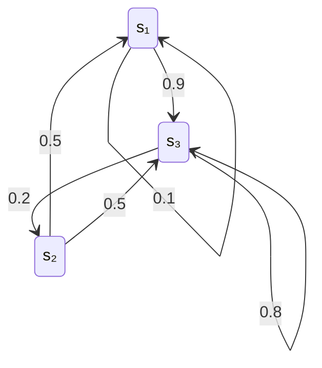

# 从单个符号到整个信源

[[信息熵]]讨论单个随机变量的不确定性，以及两个变量之间的联合熵、条件熵和互信息。研究一个持续输出消息的[[信源]]，还要回答三个问题：前后符号的依赖如何影响平均信息量；幅度连续时怎样定义熵；已知信源的统计结构后，能减少多少传输或存储开销。

教材第 2.5、2.6、2.7 节依次围绕这三个问题展开。本笔记沿用教材的$H_N(X)$、$H_\infty(X)$、$H_c(X)$、$\eta$与$\gamma$等记号，默认$\log=\log_2$。使用自然对数$\ln$时，信息量单位相应为奈特（nat）。

| 记号 | 含义 | 所描述的范围 |
| --- | --- | --- |
| $H(X_1)$ | 单符号熵 | 单看一个位置的不确定性 |
| $H(X^N)$ | 长度为$N$的序列联合熵 | 一整组符号的不确定性 |
| $H_N(X)=H(X^N)/N$ | 分组后的每符号平均熵 | 按$N$个符号一组计算的平均信息量 |
| $H(X_N\mid X_1\cdots X_{N-1})$ | 已知前文时的条件熵 | 第$N$个符号新增的信息量 |
| $H_\infty(X)$ | 极限熵，也称熵率 | 长期平均每个符号新增的信息量 |
| $H_c(X)$ | 连续变量的微分熵 | 固定幅度尺度下由概率密度定义的熵 |

# 2.5 离散信源序列的熵

## 2.5.1 消息序列信息量的一般表达式

### 扩展信源：把一组符号看成一个新符号

设信源每次输出一个符号，符号集为$A=\{a_1,\dots,a_r\}$。长度为$N$的输出序列用随机矢量表示：

$$
X^N=(X_1,X_2,\dots,X_N)
$$

将每个可能的$N$元组看成一个新符号，就得到原信源的**$N$次扩展信源**。它的符号集$A^N$共有$r^N$个元组，其中一些元组的出现概率可以为零。

若某个具体序列记为$\alpha=(a_{i_1},\dots,a_{i_N})$，则其概率和自信息量为：

$$
p(\alpha)=P(X_1=a_{i_1},\dots,X_N=a_{i_N}),\qquad
I(\alpha)=-\log p(\alpha)
$$

对所有序列求平均，得到**序列联合熵**：

$$
\boxed{
H(X^N)=H(X_1\cdots X_N)
=-\sum_{\alpha\in A^N}p(\alpha)\log p(\alpha)
}
$$

它以比特/组计；除以每组符号数后，得到以比特/符号计的平均熵：

$$
\boxed{H_N(X)=\frac1N H(X_1\cdots X_N)}
$$

扩展信源同时保留了符号出现频率和组内的依赖关系，因此能够描述单符号概率表无法体现的结构。[^序列与无记忆]

### 概率链式分解与熵的链式法则

对任意具有正概率的具体序列，有：

$$
p(x_1,\dots,x_N)
=p(x_1)\prod_{n=2}^{N}p(x_n\mid x_1,\dots,x_{n-1})
$$

取负对数，乘积变成求和：

$$
I(x_1,\dots,x_N)
=I(x_1)+\sum_{n=2}^{N}I(x_n\mid x_1,\dots,x_{n-1})
$$

再按联合分布求期望，就得到：

$$
\boxed{
H(X_1\cdots X_N)
=H(X_1)+\sum_{n=2}^{N}H(X_n\mid X_1\cdots X_{n-1})
}
$$

这条公式可以理解为逐步确定整段消息：第一个符号提供初始信息，后续每个符号提供在已有前文基础上新增的信息。组内存在依赖时，前文能够帮助预测后文，新增的信息量就会减少。

## 2.5.2 离散无记忆信源的熵

若各位置的输出相互独立，条件概率退化为边缘概率：

$$
p(x_1,\dots,x_N)=\prod_{n=1}^{N}p(x_n)
$$

由链式法则可得：

$$
H(X_1\cdots X_N)=\sum_{n=1}^{N}H(X_n),\qquad
H_N(X)=\frac1N\sum_{n=1}^{N}H(X_n)
$$

若输出还同分布，即通常所说的离散无记忆信源，则所有位置的熵相同：

$$
\boxed{H(X^N)=NH(X_1),\qquad H_N(X)=H(X_1)}
$$

因此，独立同分布信源中，扩大分组不会减少理论上的每符号平均信息量。实际编码仍可通过扩大分组，减小码长取整数等因素造成的开销。[^序列与无记忆]

例如，等概率输出$0,1$时，单符号熵为$1$；任意$N$个符号的联合熵为$N$，每符号平均熵始终为$1$比特/符号。

## 2.5.3 离散有记忆信源的熵

### 平稳性：平移观察起点，统计规律不变

下面讨论有限字母表的离散平稳信源。这里的平稳性指各阶联合分布具有时间平移不变性，即[[平稳随机过程#严格平稳过程|严格平稳性]]。例如，对任意长度$N$和允许的起点$k$，有：

$$
P(X_1=x_1,\dots,X_N=x_N)
=P(X_{k+1}=x_1,\dots,X_{k+N}=x_N)
$$

它保证各位置具有相同的边缘分布，同时也保证相同相对位置的联合分布一致。符号之间仍然可以具有很强的依赖。

### 先看两个相邻符号

记相邻符号的联合概率为$p(a_i,a_j)$，条件概率为$p(a_j\mid a_i)$。已知前一个符号时，后一个符号的平均新增信息量为：

$$
\begin{aligned}
H(X_2\mid X_1)
&=\sum_i p(a_i)H(X_2\mid X_1=a_i)\\
&=-\sum_{i,j}p(a_i,a_j)\log p(a_j\mid a_i).
\end{aligned}
$$

于是：

$$
\begin{aligned}
H(X_1X_2)&=H(X_1)+H(X_2\mid X_1),\\
H_2(X)&=\frac12\bigl[H(X_1)+H(X_2\mid X_1)\bigr].
\end{aligned}
$$

平稳性与条件熵的性质给出：

$$
H(X_1)=H(X_2),\qquad
H(X_2\mid X_1)\leq H(X_1),\qquad
H_2(X)\leq H(X_1)
$$

后两个不等式的等号，当且仅当这两个相邻符号独立时成立。依赖关系使两个符号包含一部分重复信息，所以两者的联合熵不超过单符号熵的两倍。[^有记忆与极限熵]

### 教材例 2.12：同样的符号频率，不同的序列结构

设两个符号的边缘概率均为$0.5$，相邻符号的联合分布为：

$$
P_{X_1X_2}=\begin{bmatrix}
0.45&0.05\\
0.05&0.45
\end{bmatrix}
$$

单看任何一个位置，两种结果同样可能，因此$H(X_1)=1$。但相邻符号有$0.9$的概率相同，知道前一个符号后，对下一个符号就有较强的预测依据：

$$
\begin{aligned}
H(X_2\mid X_1)&=-0.9\log0.9-0.1\log0.1\approx0.4690,\\
H(X_1X_2)&=1+0.4690\approx1.4690,\\
H_2(X)&\approx0.7345\ \text{比特/符号}.
\end{aligned}
$$

其中，$0.4690$描述已知前一个符号后新增的信息；$0.7345$还平均了每组第一个符号的初始不确定性。它们衡量的范围不同，因而数值也不同。

### 一般平稳信源：四个重要结论

为便于推导，暂记：

$$
c_1=H(X_1),\qquad
c_N=H(X_N\mid X_1\cdots X_{N-1})\quad(N\geq2)
$$

这里$c_N$表示第$N$个符号在前文已知后的新增信息量。链式法则立即给出：

$$
H(X^N)=\sum_{n=1}^{N}c_n,\qquad
H_N(X)=\frac1N\sum_{n=1}^{N}c_n
$$

**结论一：新增信息量随可利用的前文增长而非递增。**

$$
\boxed{0\leq c_N\leq c_{N-1}\leq\cdots\leq c_1}
$$

证明结合了两个步骤：增加条件不会增加平均条件熵；平稳性允许整体平移下标。

$$
\begin{aligned}
H(X_N\mid X_1\cdots X_{N-1})
&\leq H(X_N\mid X_2\cdots X_{N-1})\\
&=H(X_{N-1}\mid X_1\cdots X_{N-2}).
\end{aligned}
$$

对$N=2$，相应结论就是$H(X_2\mid X_1)\leq H(X_1)$。

**结论二：分组平均熵不小于最后一个符号的新增信息量。**

$$
\boxed{H_N(X)\geq c_N}
$$

因为$H_N(X)$是$c_1,\dots,c_N$的平均，而$c_N$是其中最小的一项。对整组求平均时，组开头利用的前文较少，因此平均值包含了较大的初始不确定性。

**结论三：分组平均熵随组长增长而非递增。**

$$
\boxed{H_N(X)\leq H_{N-1}(X)}
$$

可由下式看出：

$$
H_N(X)=\frac{N-1}{N}H_{N-1}(X)+\frac1N c_N
$$

新加入的$c_N$不大于先前的平均值，因此新的平均值不会增加。扩大分组使组内能够利用更长的依赖关系，同时摊薄组开头的开销。

**结论四：两类平均量趋于相同的极限。**

$$
\boxed{
H_\infty(X)
=\lim_{N\to\infty}H_N(X)
=\lim_{N\to\infty}H(X_N\mid X_1\cdots X_{N-1})
}
$$

$c_N$非递增且下界为零，所以存在极限；收敛序列的算术平均具有相同极限，因而$H_N(X)$也收敛到该值。教材称它为**极限熵**或极限信息量，通常也称**熵率**，单位为比特/符号。这里的“率”按符号数归一化。

综合起来：

$$
0\leq H_\infty(X)\leq c_N\leq H_N(X)\leq H_1(X)\leq\log r
$$

熵率描述充分利用过去信息后，信源每输出一个符号仍会产生多少新的不确定性。用有限组长近似时，$H_N(X)$与$c_N$都给出熵率的上界；平稳性本身不规定它们收敛得多快。[^有记忆与极限熵]

## 2.5.4 马尔可夫信源的熵

### 有限记忆：用最近的符号概括全部前文

若下一个符号的条件分布只依赖前$m$个符号，则称为**$m$阶马尔可夫信源**：

$$
p(x_n\mid x_1,\dots,x_{n-1})
=p(x_n\mid x_{n-m},\dots,x_{n-1})\qquad(n>m)
$$

因此：

$$
p(x_1,\dots,x_N)
=p(x_1,\dots,x_m)
\prod_{n=m+1}^{N}p(x_n\mid x_{n-m},\dots,x_{n-1})
$$

一阶情形特别简单：

$$
p(x_1,\dots,x_N)=p(x_1)\prod_{n=2}^{N}p(x_n\mid x_{n-1})
$$

有限记忆指的是：已知最近$m$个符号后，更早历史不再改变下一个符号的条件分布。相隔很远的符号仍可能通过中间状态形成统计依赖。

### 状态、齐次转移与稳态分布

对$m\geq1$，把输出前最近的$m$个符号作为状态：

$$
S_{n-1}=(X_{n-m},\dots,X_{n-1})
$$

状态至多有$r^m$种可能值。输出新符号后，删去最旧符号、加入新符号，得到下一状态$S_n$。这样，$m$阶符号信源就表示为一阶状态链。

若状态转移概率与时刻无关，则称转移为**齐次**。采用行概率向量约定，其转移矩阵为：

$$
P=(p_{ij}),\qquad
p_{ij}=P(S_n=s_j\mid S_{n-1}=s_i),\qquad
p_{ij}\geq0,\quad\sum_jp_{ij}=1
$$

多步转移与状态分布满足：

$$
P^{(k)}=P^k,\qquad W_n=W_0P^n
$$

**稳态分布**$W=(w_1,\dots,w_K)$满足：

$$
\boxed{WP=W,\qquad \sum_iw_i=1,\qquad w_i\geq0}
$$

它表示一次转移前后状态分布保持不变。从这个分布初始化齐次链，就得到平稳的状态过程。对有限状态、不可约且非周期的链，任意初始分布还会随着转移趋于唯一的稳态分布。[^马尔可夫]

### 熵率：先在每个状态内求熵，再对状态求平均

已知当前状态$s_i$时，下一符号的熵为：

$$
H(X\mid s_i)
=-\sum_{j=1}^{r}p(a_j\mid s_i)\log p(a_j\mid s_i)
$$

在稳态分布下，马尔可夫信源的熵率为：

$$
\boxed{
H_\infty(X)=\sum_{i=1}^{K}w_iH(X\mid s_i)
=-\sum_i\sum_jw_i p(a_j\mid s_i)\log p(a_j\mid s_i)
}
$$

这个公式有两层平均：先计算某个状态下输出新符号的平均不确定性，再按各状态的稳态概率加权。对于以最近$m$个符号为状态的表示，每个下一符号对应唯一的后继状态，因此也可以对状态转移矩阵的每一行求熵，再按$w_i$加权。

对于平稳的$m$阶马尔可夫信源，足够长的前文可以缩短为最近$m$个符号：

$$
\boxed{H_\infty(X)=H(X_{m+1}\mid X_1\cdots X_m)}
$$

相应地，对$N\geq m\geq1$：

$$
\begin{aligned}
H(X^N)&=H(X_1\cdots X_m)+(N-m)H_\infty(X),\\
H_N(X)&=H_\infty(X)
+\frac{H(X_1\cdots X_m)-mH_\infty(X)}{N}.
\end{aligned}
$$

初始状态的不确定性只占有限开销，组长增大后，它对每符号平均值的影响趋于零。

### 教材例 2.13：由转移矩阵计算熵率

设一阶马尔可夫信源的转移矩阵为：

$$
P=\begin{bmatrix}
0.1&0&0.9\\
0.5&0&0.5\\
0&0.2&0.8
\end{bmatrix}
$$

每一行给出已知当前状态后，下一个状态的概率分布：

**第一步，求稳态概率。** 将$WP=W$展开为：

$$
\begin{cases}
w_1=0.1w_1+0.5w_2,\\
w_2=0.2w_3,\\
w_3=0.9w_1+0.5w_2+0.8w_3,\\
w_1+w_2+w_3=1.
\end{cases}
$$

解得：

$$
W=\left(\frac5{59},\frac9{59},\frac{45}{59}\right)
$$

**第二步，计算各状态下的输出熵。**

| 当前状态 | 下一状态的概率分布 | 条件熵（比特/符号） |
| --- | --- | --- |
| $s_1$ | $(0.1,0,0.9)$ | $H(X\mid s_1)\approx0.4690$ |
| $s_2$ | $(0.5,0,0.5)$ | $H(X\mid s_2)=1$ |
| $s_3$ | $(0,0.2,0.8)$ | $H(X\mid s_3)\approx0.7219$ |

**第三步，按稳态概率加权。**

$$
\begin{aligned}
H_\infty(X)
&=\frac5{59}H(X\mid s_1)+\frac9{59}H(X\mid s_2)
+\frac{45}{59}H(X\mid s_3)\\
&\approx0.7429\ \text{比特/符号}.
\end{aligned}
$$

状态$s_2$下的输出最不确定，但信源大部分时间处于$s_3$，最终平均值由状态概率和各状态内的熵共同决定。

### 马尔可夫记忆与独立分组的区别

| 模型 | 依赖结构 | 相应的每符号信息量 |
| --- | --- | --- |
| 长度为$N$的独立消息组 | 组内允许有关联，各组独立同分布 | $H(X_1\cdots X_N)/N$ |
| 平稳的$m$阶马尔可夫信源 | 每次输出依赖最近$m$个符号，依赖跨越任意人为组界 | $H(X_{m+1}\mid X_1\cdots X_m)$ |

因此，分组长度和记忆阶数分别描述观察范围与条件依赖，计算时应根据模型选用联合熵或条件熵。[^马尔可夫]

# 2.6 连续信源的熵与互信息量

## 2.6.1 幅度连续的单个符号信源

### 从量化后的离散熵出发

设连续随机变量$X$具有概率密度$p_X(x)$。密度在区间上积分才得到概率，例如：

$$
P(u\leq X<v)=\int_u^v p_X(x)\,dx,\qquad
\int_{-\infty}^{\infty}p_X(x)\,dx=1
$$

对幅度作均匀量化，量化间隔为$\Delta x$。记离散量化结果为$X_{\Delta x}$，第$i$个量化区间为$B_i$，则：

$$
p_i=P(X\in B_i)=\int_{B_i}p_X(x)\,dx
\approx p_X(x_i)\Delta x
$$

将它代入离散熵：

$$
\begin{aligned}
H(X_{\Delta x})
&\approx-\sum_i p_X(x_i)\Delta x\log[p_X(x_i)\Delta x]\\
&=-\sum_i p_X(x_i)\Delta x\log p_X(x_i)
-\log\Delta x\sum_i p_X(x_i)\Delta x.
\end{aligned}
$$

对于足够规则且微分熵有限的密度，在高精度均匀量化下，可以写成：

$$
\boxed{H(X_{\Delta x})=H_c(X)-\log\Delta x+o(1)}
$$

这里$o(1)$表示随$\Delta x\to0$趋于零的误差。第一项反映概率密度的形状，第二项反映量化精度：量化间隔缩小一半，记录每个样本平均约需再增加$1$比特。[^连续单符号]

### 微分熵的定义

保留上述表达式中与量化间隔无关的部分，定义：

$$
\boxed{
H_c(X)=-\int_{-\infty}^{\infty}p_X(x)\log p_X(x)\,dx
}
$$

教材将$H_c(X)$称为连续信源的熵，也使用“相对熵”或“差熵”的名称。本笔记统一称为**微分熵**；KL 散度则采用[[信息熵#与相对熵的关系|相对熵（KL 散度）]]的名称，两者具有不同的定义。

量化后的离散熵直接对应所需的平均描述位数；微分熵则通过去除分辨率项，提取密度分布在给定幅度单位下的特征。随着$\Delta x$趋于零，量化后的离散熵趋于无穷大，表示精确描述连续幅度需要无限精度。

### 直观理解：幅度尺度与描述精度

若$X$在$[a,b]$上均匀分布，则：

$$
p_X(x)=\frac1{b-a}\quad(a\leq x\leq b),\qquad
H_c(X)=\log(b-a)
$$

对应教材例 2.14，均匀分布在$[0,5]$上的变量有$H_c(X)=\log5\approx2.322$，而均匀分布在$[0,1]$上的变量有$H_c(Y)=0$。

这组数值体现了微分熵对幅度尺度的依赖。同样的量化间隔下，宽度为$5$的区间需要区分的量化结果，大约是宽度为$1$的区间的$5$倍，平均位数相差$\log_2 5$。若对$[0,1]$采用$\Delta x=1/256$的均匀量化，就得到$256$个等概率结果，离散熵为$8$比特。

更一般地，尺度和平移变换满足：

$$
\boxed{H_c(cX+d)=H_c(X)+\log|c|\qquad(c\neq0)}
$$

平移不改变熵，伸缩会改变熵。因而微分熵可以为正、零或负：例如$[0,1/2]$上的均匀分布有$H_c(X)=-1$。固定数值单位与量化精度后，才能把这种尺度比较转换成实际描述位数的比较。

### 连续联合熵、条件熵与互信息

设$X,Y$具有联合密度$p_{XY}(x,y)$，并满足：

$$
p_{XY}(x,y)=p_X(x)p_Y(y\mid x)
$$

在相应密度存在、所用微分熵为有限值时，有：

$$
H_c(XY)=-\iint p_{XY}(x,y)\log p_{XY}(x,y)\,dx\,dy
$$

$$
H_c(Y\mid X)=-\iint p_{XY}(x,y)\log p_Y(y\mid x)\,dx\,dy
$$

$$
\boxed{
I_c(X;Y)=\iint p_{XY}(x,y)
\log\frac{p_{XY}(x,y)}{p_X(x)p_Y(y)}\,dx\,dy
}
$$

它们仍满足链式法则和熵差关系：

$$
\begin{aligned}
H_c(XY)&=H_c(X)+H_c(Y\mid X)\\
&=H_c(Y)+H_c(X\mid Y),\\
I_c(X;Y)&=H_c(X)-H_c(X\mid Y)\\
&=H_c(Y)-H_c(Y\mid X)\\
&=H_c(X)+H_c(Y)-H_c(XY).
\end{aligned}
$$

连续互信息也可写成联合分布与边缘乘积分布之间的 KL 散度，因此：

$$
I_c(X;Y)\geq0
$$

等号当且仅当两者独立时成立。微分熵中的幅度尺度项在上述熵差中抵消，因此互信息能够衡量两个连续变量之间的统计依赖。[^连续单符号]

## 2.6.2 波形信源

### 用采样随机矢量描述一段波形

时间和幅度都连续的信源，可用随机过程$X(t)$表示。在选定的时刻采样，得到随机矢量：

$$
\mathbf X=(X(t_1),\dots,X(t_N))=(X_1,\dots,X_N)
$$

若其联合密度存在，则这组采样值的微分熵为：

$$
H_c(\mathbf X)
=-\int_{\mathbb R^N}p_{\mathbf X}(\mathbf x)
\log p_{\mathbf X}(\mathbf x)\,d\mathbf x
$$

另一波形$Y(t)$的采样矢量记为$\mathbf Y$。对它们的联合密度积分，可以同样定义$H_c(\mathbf Y\mid\mathbf X)$和$I_c(\mathbf X;\mathbf Y)$。

教材通过采样矢量维数增大的极限来形式化描述整个波形的熵。这种未经归一化的量描述全部采样值的联合不确定性；计算每个采样值或单位时间的信息量时，还要除以相应的样本数或观察时长，并考察极限是否存在。[^波形信源]

### 波形中的依赖与链式法则

在有关微分熵有限时，有：

$$
\begin{aligned}
H_c(X_1\cdots X_N)
&=H_c(X_1)+\sum_{n=2}^{N}H_c(X_n\mid X_1\cdots X_{n-1})\\
&\leq\sum_{n=1}^{N}H_c(X_n).
\end{aligned}
$$

等号当且仅当这些采样值相互独立时成立。波形通常具有时间结构，相邻采样值可以互相预测，因而联合描述所需的信息量会受到这种依赖的影响。

固定采样间隔，在相关极限存在时，可定义每采样值的微分熵率：

$$
\overline H_c=\lim_{N\to\infty}\frac1N H_c(X_1\cdots X_N)
$$

连续变量的微分熵率同样依赖幅度尺度。实际数字通信更常直接研究采样、量化后的离散序列。

### 工程路径：采样、量化，再研究离散信源

波形的数字化可以表示为：

$$
X(t)\ \xrightarrow{\text{采样}}\ (X_1,X_2,\dots)
\ \xrightarrow{\text{量化}}\ (Z_1,Z_2,\dots)
$$

采样保留选定时刻的连续幅度，量化再把幅度转换为离散符号。对理想带限信号，可按[[连续时间信号的采样|采样定理]]选取足够高的采样率，以便由样本恢复波形；量化将一个区间内的幅度合并，带来精度损失。

若量化后的序列是离散平稳信源，其熵率为$H_\infty(Z)$，采样率为$f_s$，则相应的长期每秒信息量为：

$$
\boxed{R=f_sH_\infty(Z)\quad\text{比特/秒}}
$$

这个式子连接了每符号熵和时间尺度。实际传输码率还取决于压缩方法、码长开销与传输协议。

## 2.6.3 连续信源的最大熵定理

连续变量的最大熵取决于允许的幅度范围、方差或平均功率等约束。教材讨论两类典型约束。[^连续最大熵]

### 幅度受限：均匀分布达到最大熵

若变量只能在固定区间$[a,b]$内取值，则：

$$
\boxed{H_c(X)\leq\log(b-a)}
$$

等号成立当且仅当概率密度在该区间上几乎处处均匀：

$$
p_X(x)=\begin{cases}
\dfrac1{b-a},&a\leq x\leq b,\\
0,&\text{其他}.
\end{cases}
$$

直观上，区间长度规定了可取值的空间，均匀分布则消除了偏向某些位置的先验依据，达到该幅度范围内最大的平均不确定性。

证明可将$p_X$与区间上的均匀密度$u(x)$比较：

$$
0\leq D_{\mathrm{KL}}(p_X\Vert u)
=-H_c(X)+\log(b-a)
$$

### 方差受限：高斯分布达到最大熵

若$X$的方差固定为$\sigma^2>0$，则：

$$
\boxed{H_c(X)\leq\frac12\log(2\pi e\sigma^2)}
$$

等号成立当且仅当$X$服从相应方差的高斯分布。设其均值为$\mu$，密度为：

$$
p_X(x)=\frac1{\sqrt{2\pi\sigma^2}}
\exp\left[-\frac{(x-\mu)^2}{2\sigma^2}\right]
$$

对这个密度计算熵：

$$
\begin{aligned}
H_c(X)
&=E[-\log p_X(X)]\\
&=\frac12\log(2\pi\sigma^2)
+\frac{E[(X-\mu)^2]}{2\sigma^2\ln2}\\
&=\frac12\log(2\pi e\sigma^2).
\end{aligned}
$$

固定方差下，将任意密度与相同均值、方差的高斯密度比较，KL 散度正好等于两者的微分熵之差，从而得到上述上界。熵与均值无关，体现了平移不改变不确定性的性质。

当约束写成总平均功率$E[X^2]\leq P$时，最大值由零均值、方差为$P$的高斯分布达到：

$$
H_c(X)\leq\frac12\log(2\pi eP)
$$

因为$E[X^2]=\sigma^2+\mu^2$，零均值使允许的平均功率全部用于随机波动。这也说明教材中将方差解释为功率时，对应的是交流功率；零均值时，它等于总平均功率。

### 随机矢量的对应结论

对$N$维连续随机矢量，若协方差矩阵$K$固定且正定，则多元高斯分布达到最大微分熵：

$$
H_c(\mathbf X)\leq\frac12\log\bigl[(2\pi e)^N\det K\bigr]
$$

它将“方差约束”推广到包含各分量相关性的矩阵约束。给定协方差下，高斯模型具有最大的平均不确定性，为连续信源与噪声的建模提供了重要基准。

两类最大熵定理可以归纳为：有限区间约束对应均匀分布，方差或平均功率约束对应高斯分布。若幅度尺度和功率都不受约束，通过不断扩大分布的尺度，就可以使微分熵无限增大。

# 2.7 信源相关性与冗余度

## 冗余的两个来源

冗余也称多余度或剩余度，描述当前表达方式中能够利用统计规律压缩的部分。教材将其来源归纳为符号概率的不均匀性与符号之间的依赖。[^冗余度]

**第一类：符号概率不均匀。** 对$r$个可能符号，等概率分布的熵最大。记这个基准为：

$$
H_0(X):=\log r
$$

这里$H_0$表示教材中的等概率最大熵基准。若已知实际单符号分布，则：

$$
H_1(X)=H(X_1)\leq H_0(X)
$$

频繁符号可以采用更短的描述，罕见符号采用较长的描述，因此相对于等概率基准，平均描述长度能够减少。

**第二类：前后符号有依赖。** 已知前文会缩小后文的可能范围。逐步利用更长的依赖结构时：

$$
\boxed{H_\infty(X)\leq\cdots\leq H_3(X)\leq H_2(X)\leq H_1(X)\leq H_0(X)}
$$

这个次序针对有限字母表平稳信源；各个量都以每符号为单位。符号的边缘分布给定时，独立输出具有最大的熵率，依赖关系则提供了进一步压缩的可能。这里的相关性指统计依赖，包含线性相关系数无法完整描述的结构。

两类来源可以分解为：

$$
\underbrace{H_0(X)-H_\infty(X)}_{\text{相对等概率基准的总差额}}
=\underbrace{H_0(X)-H_1(X)}_{\text{概率不均匀带来的差额}}
+\underbrace{H_1(X)-H_\infty(X)}_{\text{序列依赖带来的差额}}
$$

## 信息效率与冗余度

教材把极限熵与实际采用的有限阶平均熵之比称为**信息效率**。对$H_m(X)>0$，定义：

$$
\boxed{\eta=\frac{H_\infty(X)}{H_m(X)}}
$$

相应的**冗余度**为：

$$
\boxed{\gamma=1-\eta=1-\frac{H_\infty(X)}{H_m(X)}}
$$

因此$0\leq\eta\leq1$、$0\leq\gamma\leq1$。这里的$m$指本节选用的分组统计尺度，$H_m(X)=H(X_1\cdots X_m)/m$；马尔可夫模型的阶数则描述条件依赖长度，应按各自定义理解。

效率越接近$1$，说明所用描述尺度已接近信源的极限每符号信息量；冗余度越大，说明相对于这个基准，仍有较多可利用的统计结构。若把等概率基准$H_0(X)=\log r$作为分母，则衡量的是相对于等概率描述的总冗余：

$$
\eta_0=\frac{H_\infty(X)}{\log r},\qquad
\gamma_0=1-\frac{H_\infty(X)}{\log r}\qquad(r\geq2)
$$

给出效率或冗余度时，应同时明确分母采用哪个基准。有限阶模型的冗余、等概率基准的总冗余和实际编码器的长度开销，分别对应不同的比较对象。

## 教材的英文字母统计示例

教材采用$26$个英文字母加空格的符号集，最大熵基准为：

$$
H_0(X)=\log_2 27\approx4.755\ \text{比特/符号}
$$

教材所列统计模型给出如下近似值：

| 使用的统计描述 | 每符号熵（比特/符号） | 所利用的结构 |
| --- | --- | --- |
| 等概率基准$H_0(X)$ | $4.755$ | 只知道符号集大小 |
| 单符号熵$H_1(X)$ | $4.03$ | 各字母与空格的出现频率 |
| 两符号平均熵$H_2(X)$ | $3.32$ | 相邻符号的联合分布 |
| 三符号平均熵$H_3(X)$ | $3.1$ | 更长的联合统计结构 |
| 极限熵$H_\infty(X)$ | $1.4$ | 模型中的长期依赖结构 |

这些值用于说明该教材统计示例中的变化趋势。使用等概率基准计算：

$$
\eta_0\approx\frac{1.4}{4.755}\approx0.294,\qquad
\gamma_0\approx0.706
$$

在这个模型下，极限每符号信息量约为等概率最大熵基准的$29\%$。这个比值比较的是理想平均信息量，具体文本的压缩后大小还取决于原有编码方式、统计模型及实际编码开销。[^冗余度]

## 将序列例子与冗余联系起来

将例 2.12 的分布进一步作为平稳一阶马尔可夫信源，其条件转移矩阵为：

$$
P=\begin{bmatrix}0.9&0.1\\0.1&0.9\end{bmatrix},\qquad
W=(0.5,0.5)
$$

于是：

$$
H_0(X)=H_1(X)=1,\qquad H_\infty(X)=H(X_2\mid X_1)\approx0.4690
$$

这里没有单符号概率不均匀带来的差额，冗余全部来自序列依赖。即使每个位置上的$0,1$完全等概率，知道前一个符号后，仍能以$0.9$的概率猜中下一个符号。

从有限分组到极限熵的关系可以直接写出：

$$
H(X^N)=1+(N-1)H_\infty(X),\qquad
H_N(X)=H_\infty(X)+\frac{1-H_\infty(X)}{N}
$$

随着$N$增大，每组第一个符号的开销被逐渐摊薄，平均熵从$1$下降并趋近$0.4690$。相对于等概率基准，信息效率约为$0.4690$，冗余度约为$0.5310$。

## 压缩与可靠传输怎样利用冗余

**信源编码**利用已有的统计规律，以更短的平均描述表达同一消息。已知的符号频率、上下文和预测关系，都可以成为压缩依据。编码器与解码器必须共享相应规则，才能恢复原消息。

教材还提到用变换简化相关结构。对离散符号组，可逆的一一对应变换保持联合熵；对连续矢量，正交变换满足$|\det A|=1$，由微分熵的变换关系可得$H_c(A\mathbf X)=H_c(\mathbf X)$。变换可以使统计建模和后续编码更方便，同时保留整体信息。

**信道编码**则加入经过设计的校验关系，使接收端能够发现或纠正传输错误。它把冗余用于可靠性：压缩环节利用原信源的统计结构提高表达效率，纠错环节引入可控的结构抵抗干扰。

# 常用公式索引

| 问题 | 核心公式 | 适用条件或单位 |
| --- | --- | --- |
| 一整段离散消息包含多少信息 | $H(X^N)=H(X_1)+\sum_{n=2}^N H(X_n\mid X_1\cdots X_{n-1})$ | 一般离散序列；比特/组 |
| 按$N$个符号分组的平均值 | $H_N(X)=H(X^N)/N$ | 比特/符号 |
| 独立同分布的信源 | $H_N(X)=H(X_1)=H_\infty(X)$ | 离散无记忆信源 |
| 充分利用长期依赖后的新增信息量 | $H_\infty(X)=\lim_{N\to\infty}H_N(X)=\lim_{N\to\infty}H(X_N\mid X_1\cdots X_{N-1})$ | 有限字母表平稳信源 |
| 根据状态计算马尔可夫熵率 | $H_\infty(X)=\sum_iw_iH(X\mid s_i)$ | 状态采用稳态分布 |
| 连续幅度的量化描述 | $H(X_{\Delta x})\approx H_c(X)-\log\Delta x$ | 高精度均匀量化、足够规则的密度 |
| 有限区间内的最大微分熵 | $H_c(X)\leq\log(b-a)$ | 支撑集在$[a,b]$内；均匀分布取等 |
| 固定方差的最大微分熵 | $H_c(X)\leq\frac12\log(2\pi e\sigma^2)$ | 方差固定；高斯分布取等 |
| 教材的信息效率与冗余度 | $\eta=H_\infty(X)/H_m(X),\quad\gamma=1-\eta$ | 分母$H_m(X)>0$，应明确比较基准 |

# 参考资料与公式校核

依据邓家先、肖嵩、李英编著《信息论与编码》第 3 版第 2.5、2.6、2.7 节整理。教材中的记号和主要结论予以保留，证明步骤、模型条件与解释作了展开；微分熵的尺度公式、多元高斯上界和采样后的码率关系作为理解与应用的补充。

所用扫描版第 50 页的连续互信息公式，在对数比值积分前印有负号。本笔记采用正号，与该页后续的熵差关系及互信息的 KL 散度表达式一致。教材中的连续熵使用“相对熵”一词，本笔记统一写作“微分熵”，与 KL 散度的名称区分。

下列正文页码指页眉上的书内页码，PDF 页序从文件第一页起计数。

[^序列与无记忆]: 第 2.5.1—2.5.2 节，正文第 37—39 页：扩展信源、序列信息量和离散无记忆信源的熵。[查看教材 PDF，第 52 页起](<../../Electronic Technology/信息论与编码 第3版 (邓家先，肖嵩，李英编著, DE_ (Z-Library)(1).pdf#page=52>)。
[^有记忆与极限熵]: 第 2.5.3 节，正文第 39—46 页：二维与一般离散平稳信源、四个结论及极限熵，含例 2.12。[查看教材 PDF，第 54 页起](<../../Electronic Technology/信息论与编码 第3版 (邓家先，肖嵩，李英编著, DE_ (Z-Library)(1).pdf#page=54>)。
[^马尔可夫]: 第 2.5.4 节，正文第 46—49 页：马尔可夫信源、状态转移、稳态分布与平均符号熵，含例 2.13。[查看教材 PDF，第 61 页起](<../../Electronic Technology/信息论与编码 第3版 (邓家先，肖嵩，李英编著, DE_ (Z-Library)(1).pdf#page=61>)。
[^连续单符号]: 第 2.6.1 节，正文第 49—51 页：量化推导、连续熵、联合熵、条件熵与互信息，含例 2.14。[查看教材 PDF，第 64 页起](<../../Electronic Technology/信息论与编码 第3版 (邓家先，肖嵩，李英编著, DE_ (Z-Library)(1).pdf#page=64>)。
[^波形信源]: 第 2.6.2 节，正文第 51 页：波形信源的采样矢量、熵与条件熵及采样量化处理。[查看教材 PDF，第 66 页](<../../Electronic Technology/信息论与编码 第3版 (邓家先，肖嵩，李英编著, DE_ (Z-Library)(1).pdf#page=66>)。
[^连续最大熵]: 第 2.6.3 节，正文第 51—52 页：幅度受限与平均功率受限的最大熵定理。[查看教材 PDF，第 66 页起](<../../Electronic Technology/信息论与编码 第3版 (邓家先，肖嵩，李英编著, DE_ (Z-Library)(1).pdf#page=66>)。
[^冗余度]: 第 2.7 节，正文第 52—54 页：相关性、统计冗余、信息效率和冗余度，以及英文字母统计示例。[查看教材 PDF，第 67 页起](<../../Electronic Technology/信息论与编码 第3版 (邓家先，肖嵩，李英编著, DE_ (Z-Library)(1).pdf#page=67>)。
