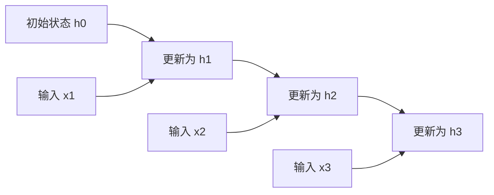

导航：[[机器学习与人工智能]]

# 核心图景：一边读序列，一边更新一份内部记录

RNN 在每个时间步接收当前输入和上一步隐藏状态，产生新的状态，再据此预测。**状态把过去的影响带到当前，同一套参数在各时间步重复使用。**

例如“我刚打开窗，屋内温度开始下降”，当前温度的解释与过去趋势有关。若预测器只看一个瞬时读数，就无法区分升温与降温过程；加入历史窗口或内部状态才能利用这部分信息。

# 问题域与发展背景

前馈网络可以把固定长度窗口拼成输入，但窗口大小需要事先规定。较长依赖、不断到来的数据和可变长度句子，使“每次都把完整过去摊开”变得不方便。

循环连接让模型反复使用一个状态更新规则。Elman 的[Finding Structure in Time，1990](https://onlinelibrary.wiley.com/doi/10.1207/s15516709cog1402_1)是简单循环网络研究的代表性工作，并非所有循环结构的唯一源头。后来序列建模扩展到语言、语音、时间序列与编码器—解码器任务。

这一设计随后暴露长期依赖的优化困难，推动 LSTM、GRU 等门控方法；序列转换中的压缩与访问问题，又推动了注意力机制。它们处理的是相互关联但不同的瓶颈。

# 一个时间步包含哪些计算

基本 Tanh RNN 写成

$$
h_t=\tanh(W_{xh}x_t+W_{hh}h_{t-1}+b_h),\quad
z_t=W_{hy}h_t+b_y.
$$

| 量 | 作用 |
|---|---|
| $x_t$ | 当前时刻的新输入 |
| $h_{t-1}$ | 之前输入留下的状态 |
| $W_{xh}$ | 决定新输入怎样进入状态 |
| $W_{hh}$ | 决定旧状态怎样参与下一状态 |
| $h_t$ | 更新后的内部表示 |
| $z_t$ | 任务头输出，可接回归损失或分类损失 |

若输入有$d$个数、状态有$m$个数，则$W_{xh}$为$m\times d$，$W_{hh}$为$m\times m$。Tanh 按分量把加权结果压到$(-1,1)$。

隐藏状态是有限维的压缩表示。它受历史输入影响，但不保证完整保存每个过去事件，更不等同于把全部原始序列原封不动存起来。

# 一个简化例子：顺序怎样留下影响

暂时去掉非线性，只看标量递推$h_t=0.5h_{t-1}+x_t$，取$h_0=0$：

| 输入序列 | 状态更新 | 最终状态 |
|---|---|---|
| $2,0,1$ | $2\to1\to1.5$ | 1.5 |
| $1,0,2$ | $1\to0.5\to2.25$ | 2.25 |

两组数相同、顺序不同，结果已经不同。较早输入会反复乘0.5，所以逐渐衰减；当前输入直接进入。这是用于看清递推的简化模型，实际 RNN 使用矩阵、多维状态与非线性。

# 将循环沿时间展开

“循环”在实现上可以想成一串相同计算单元：



这些单元共享同一组权重，训练时各次使用的梯度相加。增加时间步不会给每一步新建一份独立参数，但会增加计算量和保存激活的内存。

逐步输出适合序列标注和下一步预测；只读最终状态适合等长序列分类；编码器—解码器可把一段序列转换为另一段。

# 梯度为什么会沿时间变弱或变强

误差从后面传向前面，需要经过每一步的状态更新。相邻时间步的雅可比矩阵为

$$
J_t=\frac{\partial h_t}{\partial h_{t-1}}
=\operatorname{diag}(1-h_t^2)W_{hh}.
$$

跨多步的导数含有$J_tJ_{t-1}\cdots J_{s+1}$。矩阵中的权重和激活导数不断相乘，可能把某些方向压得很小或放得很大。

在标量简化情形下，若每一步导数都为0.5，20步后只剩$0.5^{20}\approx9.54\times10^{-7}$；若都为1.5，则为$1.5^{20}\approx3325$。前者使早期事件难以得到训练信号，后者可能使更新不稳定。

实际矩阵情形还与状态轨迹、方向和非线性有关，不能只看一个权重特征值就判定全部梯度。相关分析见[循环网络训练困难研究](https://arxiv.org/abs/1211.5063)。

# 几种改进分别处理什么

- **梯度裁剪**：限制梯度总范数，缓解爆炸；无法自动恢复已经消失的信号。
- **截断 BPTT**：只沿有限时间跨度反传，减少资源；保留状态数值与保留完整梯度历史是两回事。
- **LSTM／GRU**：学习保留、写入和输出的门控，见[[LSTM与GRU]]。
- **注意力**：让当前位置按需要访问更多历史表示，减轻只依赖一个压缩状态的限制。

RNN 的时间依赖限制了同一序列各步状态的并行计算，但不同样本和不少矩阵操作仍然可以并行。不能把它概括为完全无法使用 GPU。

# 训练、预测与状态重置

训练下一步预测时，常把真实序列作为输入，位置$t$预测真实的$t+1$。多步滚动预测则需要把自己的输出重新作为输入，误差可能累积；两者的成绩不能混用。

独立样本之间通常重置状态。连续流可以把状态传到下一段，但应明确是否切断梯度历史。双向 RNN 会访问前后文，适合离线处理，不能直接充当不允许观察未来的在线预测器。

# 形状如何对应例程

设置 `batch_first=True` 后，输入为$(B,T,1)$，逐时刻隐藏输出为$(B,T,24)$，预测头输出为$(B,T,1)$。最终状态仍按“层数×方向数、批次、隐藏维”排列，本例为$(1,B,24)$。

下方正弦任务在真实前缀条件下进行一步预测，最初几个时间点可用信息较少。理解这些前提之后，再看误差与序列图，就不会把小任务成绩误认为任意长期预测能力。

# 可复原例程

根据随机相位的正弦序列预测下一步。输入24个数，输出对应的24个下一时刻预测，最后在独立相位测试序列上绘图。

## 项目目录

```text
循环神经网络-demo/
├── runtime.py  # 统一处理项目路径、随机种子、CPU线程与计算设备
├── model.py  # 定义逐时刻读取标量并预测下一步标量的 RNN
├── main.py  # 用随机相位的正弦序列训练下一步预测，并绘制独立测试序列
└── outputs/  # 运行时自动生成，无须手工创建
```

## 环境与文件

先按[[机器学习与人工智能#统一运行环境|统一运行环境]]建立 `ml-ai-notes` 环境。以下每个代码块均为所标文件的完整内容，文件名和大小写应与目录一致。

### `runtime.py`

```python
"""统一处理项目路径、随机种子、CPU线程与计算设备。"""

# 标准库
from pathlib import Path
import argparse
import random

# 第三方库（由统一环境提供）
import numpy as np
import torch

# 1. 路径统一从 runtime.py 所在目录出发，复制项目后无须改绝对路径。
ROOT = Path(__file__).resolve().parent

# outputs/ 存放本项目的图像、指标与模型权重；不存在时自动创建。
OUT = ROOT / "outputs"
OUT.mkdir(exist_ok=True)


def setup():
    """初始化运行环境并返回 torch.device。

    命令行参数只有 --cpu；ROOT、OUT 是导入时建立的项目路径。
    """

    # 2. 读取命令行选项：--cpu 允许在有显卡的机器上仍强制使用 CPU。
    parser = argparse.ArgumentParser()
    parser.add_argument("--cpu", action="store_true")
    args = parser.parse_args()

    # 3. 固定 Python、NumPy 和 PyTorch 的随机种子；跨设备仍不保证逐位相同。
    random.seed(7)
    np.random.seed(7)
    torch.manual_seed(7)

    # 小型教学网络限制 CPU 线程数，避免线程调度开销过大。
    torch.set_num_threads(2)

    # 4. 仅当 CUDA 可用且没有指定 --cpu 时使用 GPU；调用方负责移动模型和数据。
    device = torch.device(
        "cuda" if torch.cuda.is_available() and not args.cpu else "cpu"
    )
    print("device:", device)

    # 返回 torch.device；各入口脚本共用相同的设备选择规则。
    return device
```

### `model.py`

```python
"""定义逐时刻读取标量并预测下一步标量的 RNN。"""

# 第三方库（由统一环境提供）
from torch import nn


class Predictor(nn.Module):
    """定义逐时刻读取标量并预测下一步标量的 RNN。"""

    def __init__(self):
        """创建模型组件并登记参数；本方法只定义结构，不执行训练。"""

        super().__init__()

        # 输入每步1个数，隐藏状态24维；batch_first 使输入按 (B, T, 1) 排列。
        self.rnn = nn.RNN(1, 24, batch_first=True)

        # 共享线性头将每个时间位置的24维状态映射为1个预测值。
        self.head = nn.Linear(24, 1)

    def forward(self, x):
        """输入 (B, T, 1)，返回逐步预测和 RNN 最终隐藏状态。"""

        # sequence 为 (B, T, 24)，包含全部时间步；state 为 (1, B, 24)，仅是最终状态。
        sequence, state = self.rnn(x)

        # 对每个时间步使用同一个预测头，输出 (B, T, 1)，并保留最终状态以便检查。
        return self.head(sequence), state
```

### `main.py`

```python
"""用随机相位的正弦序列训练下一步预测，并绘制独立测试序列。"""

# 标准库
import json

# 第三方库（由统一环境提供）
import torch
import matplotlib

# 采用不弹出窗口的绘图后端；必须在导入 pyplot 之前设置。
matplotlib.use("Agg")
import matplotlib.pyplot as plt

# 本项目模块
from model import Predictor
from runtime import setup, OUT


def make_batch(n, device):
    """返回 n 条序列的输入与下一步目标，形状均为 (n, 24, 1)。"""

    # 1. 生成25个连续时刻，形状 (1, 25)，与各样本随机相位进行广播。
    time = torch.arange(25, device=device).view(1, -1)

    # 每个样本取一个相位；训练与测试具有相同频率，但相位独立生成。
    phase = torch.rand(n, 1, device=device) * 6.28
    sequence = torch.sin(0.35 * time + phase)

    # 前24个值是输入，后24个值是目标；最后一维 None 增加单通道特征维。
    return sequence[:, :-1, None], sequence[:, 1:, None]


def main():
    """用随机相位的正弦序列训练下一步预测，并绘制独立测试序列。

    按分段注释依次准备数据、执行计算并保存结果。
    """

    # 2. 初始化设备、网络与优化器。
    device = setup()
    model = Predictor().to(device)
    optimizer = torch.optim.Adam(model.parameters(), lr=0.01)

    # 3. 每次更新重新生成64条序列；目标始终是比输入晚一个时刻的真实值。
    for step in range(220):
        x, y = make_batch(64, device)

        # 清除上一轮梯度；PyTorch 的 backward 默认会累加到 .grad。
        optimizer.zero_grad()

        # 模型一次输出全部位置的预测；MSE 对批次、时间和特征维求平均。
        prediction, state = model(x)

        # 构造当前批次的标量训练目标，反向传播将从这里开始。
        loss = (prediction - y).square().mean()

        # 沿计算图计算参数梯度；此时参数数值尚未更新。
        loss.backward()

        # 限制全部参数梯度的总范数，缓解梯度爆炸；不改变前向预测。
        torch.nn.utils.clip_grad_norm_(model.parameters(), 1.0)

        # 优化器根据当前梯度真正更新可训练参数。
        optimizer.step()

    # 切换到评价模式；若含 Dropout／BatchNorm，其行为随之切换。
    model.eval()

    # 不记录这一段的求导图；适用于评价、参数初始化或手动更新。
    with torch.no_grad():
        # 4. 训练结束后另外采样128条序列，用于独立的一步预测评价。
        x, y = make_batch(128, device)

        # 模型一次输出全部位置的预测；MSE 对批次、时间和特征维求平均。
        prediction, state = model(x)
        mse = (prediction - y).square().mean().item()

    # 5. 保存测试误差与两种输出形状，区分逐步输出和最终状态。
    report = {
        "test_mse": mse,
        "output_shape": list(prediction.shape),
        "state_shape": list(state.shape),
    }
    print(report)
    (OUT / "metrics.json").write_text(json.dumps(report, indent=2), encoding="utf-8")

    # 6. 只画测试集第一条序列，横轴为时间位置。
    fig, ax = plt.subplots(figsize=(7, 3))

    # 这里使用真实前缀进行一步预测；没有把先前预测重新喂给模型。
    ax.plot(y[0, :, 0].cpu(), label="next-step truth")
    ax.plot(prediction[0, :, 0].cpu(), "--", label="prediction")
    ax.legend()

    # 自动调整子图间距，避免标题和坐标标签被裁切。
    fig.tight_layout()
    fig.savefig(OUT / "sequence.png", dpi=140)

    # 关闭已保存的图对象，避免反复运行时积累绘图资源。
    plt.close(fig)
    torch.save(model.state_dict(), OUT / "rnn.pt")


if __name__ == "__main__":
    main()
```

## 运行步骤

在 VS Code 中打开项目根目录，选择 `ml-ai-notes` 的 Python 解释器，再在终端执行：

```powershell
# 先激活环境，让下面的 python 使用指定解释器和依赖。
conda activate ml-ai-notes

# 从项目根目录执行主入口，结果将写入本项目的 outputs/。
python main.py
```

所有相对输出路径均以代码所在目录为基准；运行生成的文件位于 `outputs/`。

## 结果与解释

输出形状应为 `(128, 24, 1)`，最终状态为 `(1, 128, 24)`。前几个时间步可用信息较少，误差可能更大。`sequence.png` 展示基于真实输入的一步预测，独立测试只改变相位，不代表能外推到任意频率。

## 实测记录

2026-10-25，在[[机器学习与人工智能#统一运行环境|统一运行环境]]中从上述代码块还原项目进行验证。数值与生成结果会受硬件和随机过程影响，不能要求逐位一致。

| 入口 | CPU | CUDA |
|---|---|---|
| `main.py` | 运行通过（16.4秒） | 运行通过（16.7秒） |

CPU 运行的主要观测：一步预测测试 MSE 0.00828；输出形状 [128, 24, 1]，最终隐藏状态 [1, 128, 24]。

## 小实验

- 改变测试频率，检查分布变化。
- 将输出再次输入网络，另外实现滚动预测并比较误差累积。
- 增大输入序列长度，观察训练耗时与梯度范数。

# 关联阅读

- [[损失函数与梯度下降]]
- [[LSTM与GRU]]
- [[注意力机制]]

# 参考资料

- [PyTorch：RNN](https://pytorch.org/docs/2.2/generated/torch.nn.RNN.html)
- [On the difficulty of training recurrent neural networks](https://arxiv.org/abs/1211.5063)
